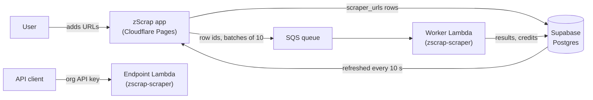
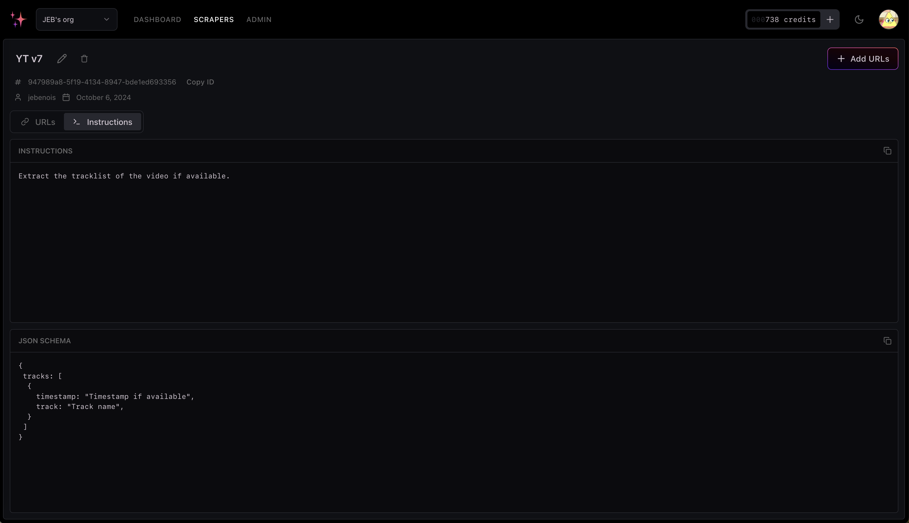
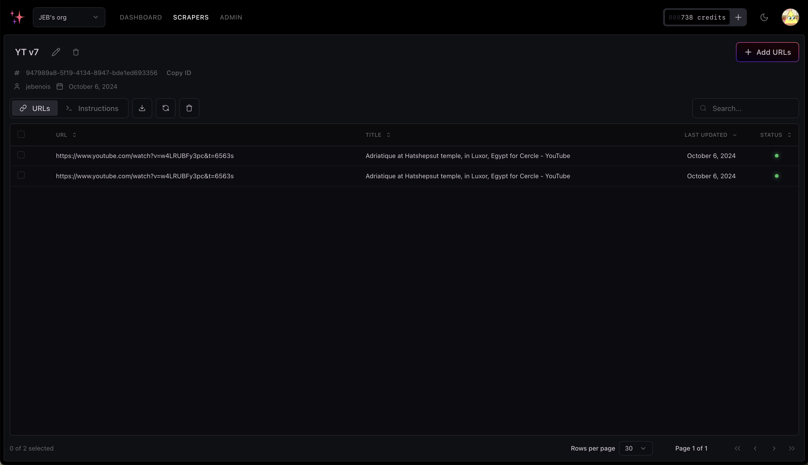
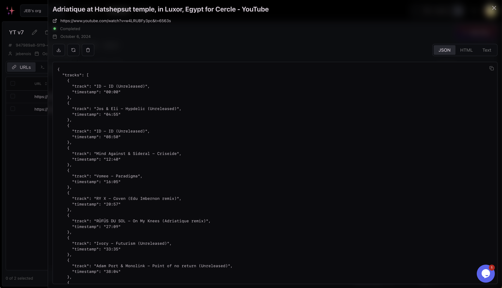
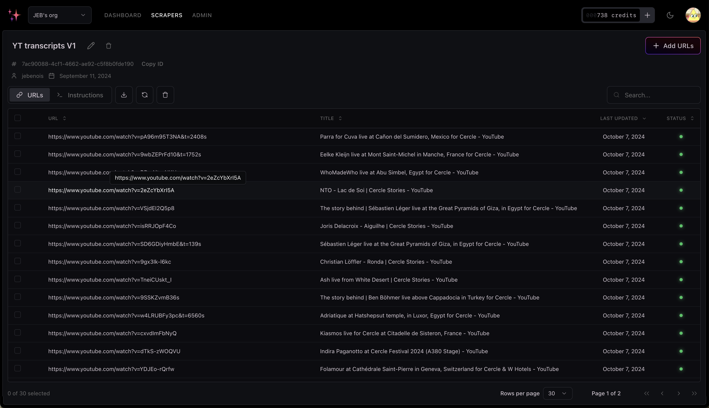
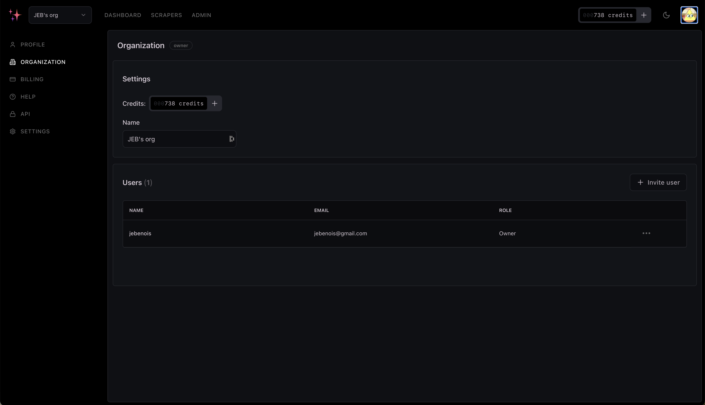
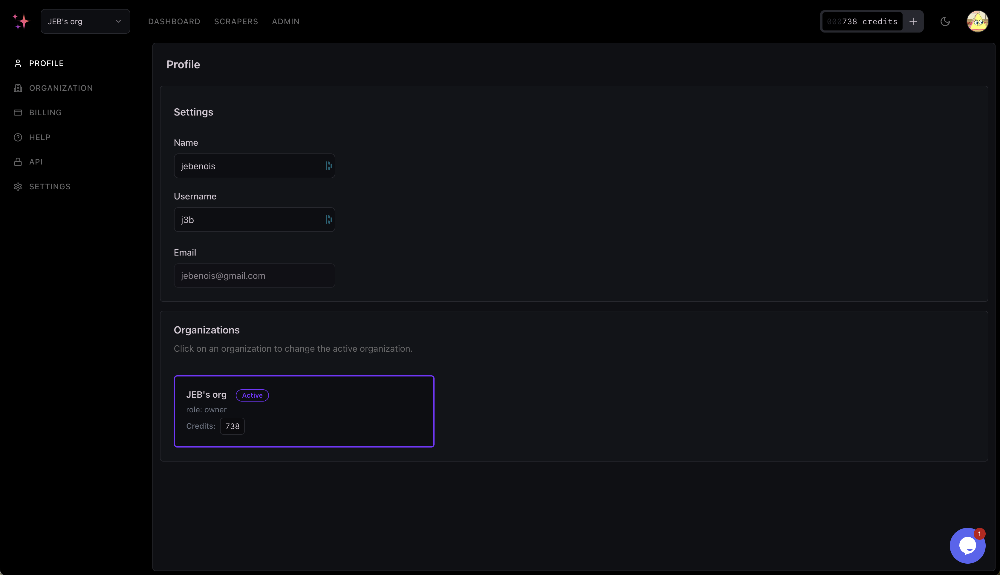

# zScrap

<p align="center"></p>

> [!WARNING]
> ⚠️ **Archived project (2024).** zScrap was never launched publicly. It is not maintained and is kept here as a record.

The web app for zScrap, an AI web-scraping service built in 2024. Users create a scraper by describing what to extract in plain English, optionally with a JSON schema, then add the URLs to scrape. The scraping runs in [`zscrap-scraper`](https://github.com/l4j3b/zscrap-scraper), and the results come back here to browse and export as CSV or JSON. Each organization also gets an API key to call the scraper directly, paid for with credits.

It started as a way to pull tracklists out of YouTube DJ sets, where they sit in descriptions and comments in a different format every time.

## How the two repos worked together

| Repo | Role | Ran on |
| --- | --- | --- |
| `zscrap` (this repo) | The website and app: sign-up, organizations, scrapers and results, API keys, credits and billing, admin tools | Cloudflare Pages |
| [`zscrap-scraper`](https://github.com/l4j3b/zscrap-scraper) | The scraping backend: an SQS queue and worker Lambda for jobs from this app, and a public endpoint for API calls | AWS Lambda and SQS |



When a user adds or refreshes URLs, the app saves them as `scraper_urls` rows and sends their ids to SQS. The worker Lambda in `zscrap-scraper` renders each page, extracts the data with GPT-4o-mini, takes a credit, and writes the result back to the row. The scraper page refreshes its data every 10 seconds while jobs are running, so results appear as they finish.

## Screenshots

**Instructions:** the plain-English prompt and the JSON schema the model fills, here for YouTube tracklists.



**URLs:** a batch of links with the page title, last update and status after a run.



**Result:** one finished job as structured JSON (tracks and timestamps), with JSON, HTML and text views.



**Larger batches:** dozens of URLs in one scraper.



**Organization:** the name, credits, members and roles.



**Profile:** account settings and the organizations you belong to.



## Features

- **Auth:** Supabase email and password sign-in, OAuth, password reset and email confirmation. Sign-ups are gated by a whitelist, and admins are set by email ([`config.ts`](app/lib/auth.server/config.ts)).
- **Organizations:** members with roles, adding and removing members, and switching between organizations.
- **Scrapers:** a prompt and optional JSON schema per scraper; adding, refreshing and deleting URLs in bulk; per-URL results; and CSV, JSON and text exports.
- **API keys:** one per organization, generated as `sk_` plus 56 hex characters. Only an HMAC-SHA256 hash and the last four characters are stored ([`api-keys.server.ts`](app/lib/api-keys.server.ts)).
- **Credits and billing:** Stripe Checkout for credit packs and a Pro plan (daily, monthly or yearly), with signature-checked webhooks ([`webhook.server.ts`](app/lib/stripe/webhook.server.ts)). Credits are taken and refunded through the `deduct_api_credit` and `add_api_credit` Postgres functions ([`functions.ts`](drizzle/functions.ts)).
- **Admin and dev tools:** a user list with switch-user, a log of scraper errors, a session viewer, and UI and example pages.
- **Also:** email through Resend, Sentry on the client and server, and a Tawk.to support chat.

## Stack

Remix (Vite) on Cloudflare Pages, served through Hono with secure headers and sessions in Workers KV. Supabase for auth and Postgres, with Drizzle as the ORM. Tailwind with Radix-based UI components, Conform and Zod for forms, TanStack Table and Recharts. Stripe, Resend and Sentry.

## Project layout

| Path | What it is |
| --- | --- |
| [`app/routes/_website+`](app/routes/_website+) | Public pages: home, privacy, terms |
| [`app/routes/auth+`](app/routes/auth+) | Sign-in, sign-up, OAuth callback, password reset |
| [`app/routes/_app+/in+`](app/routes/_app+/in+) | The signed-in app: scrapers, account, organization, API keys, billing |
| [`app/routes/_app+/restricted+`](app/routes/_app+/restricted+) | Admin and developer pages |
| [`app/lib`](app/lib) | Auth, API keys, Stripe, SQS, Supabase and database helpers |
| [`server`](server) | Hono server, sessions and the request context |
| [`drizzle`](drizzle) | Schema, credit functions and seed data |

## Running it

Requirements: Node.js 20, a Supabase project, and a Cloudflare account for deploys.

```bash
cp .env.example .env    # fill in the values
cp .env .dev.vars       # Wrangler reads local secrets from .dev.vars
npm install
npm run drizzle:push       # create the tables
npm run drizzle:functions  # create the credit functions
npm run drizzle:seed       # create admin@example.com and user5@example.com (password from SEED_USER_PASSWORD)
npm run dev
```

Besides `.env.example`, the app expects `API_KEY_SECRET`, the AWS credentials and `SCRAPER_SQS_QUEUE_URL` for the queue, `SENTRY_DSN`, and `SEED_USER_PASSWORD` for the seed script (see [`worker-configuration.d.ts`](worker-configuration.d.ts)). In [`wrangler.toml`](wrangler.toml), replace the placeholder KV namespace id and URLs with your own.

To test Stripe webhooks locally, run `npm run stripe:listen`. To deploy, run `npm run build` and then `npm run deploy`.
